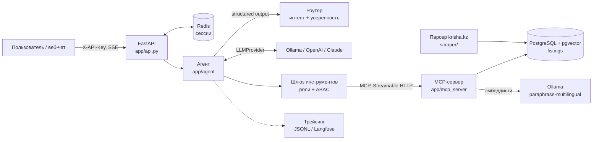

# Almaty Realty Agent

LLM-агент для рынка квартир Алматы. Отвечает на вопросы вроде «двушка в Бостандыкском до 50 млн», «где самый дорогой квадратный метр», «квартира с видом на горы», «сравни эти два объявления», вызывая инструменты через MCP поверх базы из 41 277 объявлений с krisha.kz (снимок на 3 октября 2026).

Работает целиком на бесплатной локальной модели (Ollama, `qwen2.5:3b`, 8 ГБ RAM). Переключение на OpenAI или Claude меняет только переменные окружения.

## Архитектура



Путь одного запроса:

1. **API** проверяет ключ, достаёт роль и историю сессии из Redis (сессия привязана к владельцу).
2. **Роутер** определяет интент (`search`, `stats`, `compare`, `sql`, `chitchat`, `out_of_scope`). Это каскад: сначала семантический роутер сравнивает эмбеддинг вопроса с размеченными примерами (~50 мс, без LLM). Если лучший интент опережает второй меньше чем на 0,1 по косинусному сходству, решает LLM-роутер со structured output, который видит историю диалога. Ниже порога уверенности (`ROUTER_MIN_CONFIDENCE`) агент задаёт уточняющий вопрос, вопросы не по теме вежливо отклоняет без инструментов.
3. **Шлюз** отдаёт модели только инструменты, которые нужны для интента **и** разрешены роли.
4. **Цикл агента**: модель вызывает инструменты, результаты возвращаются ей же, и так до ответа или до лимита шагов (`AGENT_MAX_STEPS`). После лимита агент делает финальный вызов без инструментов и отвечает тем, что уже собрал.
5. Каждый вызов модели и инструмента пишется в трейс: задержка, токены, стоимость.

## Что где лежит

| Путь | Что делает |
|---|---|
| `scraper/` | Асинхронный парсер krisha.kz: пауза между запросами, повторы с экспоненциальной задержкой, upsert в PostgreSQL. Обходит город по числу комнат, потому что сайт не отдаёт больше ~1 500 страниц одного поиска |
| `app/mcp_server/` | MCP-сервер: `search_listings`, `search_descriptions` (RAG), `get_listing`, `district_stats`, `compare_listings`, `run_sql` (только чтение). SQL отделён от MCP в `queries.py` |
| `scraper/embed.py` | Эмбеддинги объявлений в pgvector через Ollama |
| `app/llm/` | Провайдеро-независимый интерфейс `LLMProvider`, реализации для OpenAI-совместимых API (OpenAI, Ollama, vLLM, Groq) и Anthropic, цепочка запасных движков, оценка стоимости |
| `app/agent/` | Каскад роутеров (семантический + LLM), цикл агента, проверки аргументов (guardrails) |
| `app/gateway.py` | Фильтрация инструментов по ролям, повторная проверка прав на каждом вызове, ABAC-ограничения, таймауты |
| `app/observability.py` | Спаны с задержкой, токенами и стоимостью; JSONL всегда, Langfuse при наличии ключей |
| `app/api.py` | `POST /chat`, `POST /chat/stream` (SSE), `GET /health`, веб-чат на `/` |
| `evals/` | Тестовые вопросы агента (`run.py`) и оценка поиска (`retrieval.py`) |
| `tests/` | Юнит-тесты (агент на фейковой модели, политики доступа, парсер, SQL-хелперы) |

## Запуск

Нужны Docker и [Ollama](https://ollama.com/download).

```bash
ollama pull qwen2.5:3b
cp .env.example .env

docker compose up -d postgres redis              # база и Redis
python -m venv .venv && .venv/bin/pip install -r requirements.txt -r requirements-dev.txt
.venv/bin/python -m scraper.run                  # ~1 час, ~41 000 объявлений
# или для проверки: .venv/bin/python -m scraper.run --pages 5
ollama pull paraphrase-multilingual
.venv/bin/python -m scraper.embed                # ~15 минут

docker compose --profile app up -d --build       # MCP-сервер и API
open http://localhost:8000                       # веб-чат
```

Без Docker для приложения: `python -m app.mcp_server` и `uvicorn app.api:app --port 8000`.

```bash
curl -N localhost:8000/chat/stream -H 'X-API-Key: agent-key' -H 'Content-Type: application/json' \
     -d '{"message": "Найди двушку в Бостандыкском районе до 50 млн"}'
```

## Смена движка — настройка, а не переделка

```bash
# Ollama (по умолчанию)
LLM_PROVIDER=openai_compat LLM_MODEL=qwen2.5:3b LLM_BASE_URL=http://localhost:11434/v1
# OpenAI
LLM_PROVIDER=openai_compat LLM_MODEL=gpt-4.1-mini LLM_BASE_URL= LLM_API_KEY=sk-...
# Claude
LLM_PROVIDER=anthropic LLM_MODEL=claude-haiku-4-5 LLM_API_KEY=sk-ant-...
# Запасной движок, если основной упал после всех повторов
LLM_FALLBACK__PROVIDER=openai_compat LLM_FALLBACK__MODEL=gpt-4.1-mini LLM_FALLBACK__API_KEY=sk-...
```

Агент работает только с типами из `app/llm/base.py`, поэтому новый вендор — это ещё один класс с методом `chat()`. Structured output у OpenAI-совместимых API идёт через `response_format: json_schema`, у Anthropic через принудительный вызов инструмента.

## Доступ: роли и атрибуты

| Роль | Ключ (демо) | Инструменты | Атрибуты |
|---|---|---|---|
| guest | `guest-key` | поиск, поиск по тексту, статистика | не больше 5 результатов |
| agent | `agent-key` | + объявление по id, сравнение | до 20 результатов |
| admin | `admin-key` | + `run_sql` (только чтение, таймаут 5 с) | до 20 результатов |

Права проверяются дважды: модель не видит запрещённые инструменты, а шлюз заново проверяет каждый вызов, потому что модель может назвать инструмент, которого ей не давали. Чужую сессию прочитать нельзя: сессия привязана к пользователю.

## Как агент справляется с отказами

| Ситуация | Что происходит |
|---|---|
| Сеть, 429, 5xx у провайдера | Повторы SDK с экспоненциальной задержкой, затем запасной движок (если настроен) |
| Аргументы не JSON | Модель получает ошибку с объяснением и может повторить вызов |
| Неверный район или фильтр | Инструмент отвечает понятной ошибкой со списком допустимых значений |
| Инструмент завис | Таймаут на шлюзе (`TOOL_TIMEOUT_S`), модели уходит ошибка, цикл продолжается |
| Модель зациклилась | Одинаковые вызовы отдаются из кэша, лимит шагов, финальный ответ без инструментов |
| Модель вернула пустой ответ | Повторный запрос вызова инструмента через structured output, где декодирование ограничено схемой |
| Модель придумала фильтр | Guardrail выкидывает текстовые фильтры, которых нет в словах пользователя |
| «до 40 млн» попало в нижнюю границу | Guardrail переносит значение в верхнюю границу |
| Роутер не уверен | Уточняющий вопрос вместо догадки |
| LLM-роутер отнёс «напиши функцию на Python» к `sql` | Интент `sql` засчитывается, только если в сообщении есть SQL |
| Роутер упал | Агент продолжает без него, со всеми разрешёнными инструментами |

Последние три пункта появились после того, как тестовый прогон поймал эти ошибки у `qwen2.5:3b`.

## Оценка качества

```bash
.venv/bin/python -m evals.run              # 16 вопросов
.venv/bin/python -m evals.run --repeat 3   # каждый вопрос 3 раза, чтобы мерить стабильность
```

Проверяются интент, выбранный инструмент, аргументы (включая «лишние» фильтры) и причина остановки. Результаты сохраняются в `evals/results/<модель>.json`.

### Результаты

Последний полный прогон (`--repeat 3`, `qwen2.5:3b`, до перехода на каскад роутеров):

| Метрика | Результат |
|---|---|
| Прогонов прошло | 45 / 54 |
| Стабильных вопросов (все 3 прогона прошли) | 15 / 18 |
| Интент угадан | 45 / 54 |
| Нужный инструмент | 39 / 45 |
| **Аргументы инструментов** | **33 / 33** |
| Медиана задержки | 23 с |
| Стоимость | $0 (локальная модель) |

Все провалы — ошибки роутера, причём воспроизводимые: при `temperature=0` все три повтора дают одинаковый результат.
- Запросы про особенности («вид на горы», «паркинг») LLM-роутер стабильно относил к `search`, а не к отдельному интенту `features`.
- «Напиши функцию на Python» он относил к `sql`.

Что я попробовал и что из этого вышло:
1. **Примеры в промпте роутера** (few-shot): стало хуже (14/18 на одном прогоне), модель 3B их почти не учитывает. Откатил.
2. **Самооценка уверенности LLM бесполезна**: роутер сообщал 1,0 и для правильных, и для ошибочных ответов. Поэтому порог по ней почти ничего не отсекает.
3. **Семантический роутер** сам по себе правильно классифицирует только 19 из 29 фраз, зато у него осмысленная уверенность: при разрыве больше 0,07 ошибок не было, все ошибки приходились на маленький разрыв. Отсюда каскад: уверенные случаи решаются без LLM, остальные отдаются LLM-роутеру.
4. Интент `features` убран: `search` получает оба инструмента поиска, а между `search_listings` и `search_descriptions` выбирает агент.
5. Для `sql` добавлена проверка, что SQL действительно упомянут в сообщении.

Пункты 3–5 ещё не прошли полный прогон: локальная модель остановилась посреди ночного прогона. Повторить его:

```bash
ollama serve &   # если не запущен
.venv/bin/python -m evals.run --repeat 3
```

## RAG: поиск по тексту объявлений

Структурные фильтры не выражают «вид на горы», «рядом с метро» или «есть паркинг»: это есть только в тексте объявления. Для таких запросов роутер выбирает интент `features`, и агент вызывает `search_descriptions`.

1. **Полнотекстовый поиск PostgreSQL**: `tsvector` с русской морфологией, лексемы запроса объединяются через OR, ранжирование `ts_rank_cd`.
2. **Векторный поиск pgvector** (HNSW, косинусное расстояние) по эмбеддингам `paraphrase-multilingual` из Ollama.
3. **Взвешенный Reciprocal Rank Fusion**: `score = Σ weight / (60 + rank)`, вес векторного списка 0,4. Всё это делается одним SQL-запросом.
4. **Реранкинг LLM** (необязательный): модель за один вызов со structured output упорядочивает 12 кандидатов.

Каждое решение проверено на `evals/retrieval.py`: 12 запросов, половина дословные («вид на горы»), половина перефразированные («панорама гор из окна»). Метрика — precision@5, релевантность определяет регулярное выражение по тексту объявления.

| Способ | Дословные | Перефраз | Всего | Задержка |
|---|---|---|---|---|
| Полнотекстовый | 0,97 | 0,53 | 0,75 | 0,18 с |
| Векторный | 0,60 | 0,50 | 0,55 | 0,42 с |
| Гибрид, равные веса | 0,87 | 0,47 | 0,67 | 0,19 с |
| **Гибрид, вес векторов 0,4** (по умолчанию) | **1,00** | **0,53** | **0,77** | 0,19 с |
| Гибрид + реранкинг `qwen2.5:3b` | 0,87 | 0,43 | 0,65 | 12,6 с |

Что из этого следует:
- Небольшая многоязычная модель эмбеддингов сама по себе уступает полнотекстовому поиску даже на перефразах. При равных весах она тянет гибрид вниз. С весом 0,4 векторы работают как добавка и не мешают.
- Реранкинг моделью 3B ухудшает результат и добавляет 12 секунд, поэтому по умолчанию он выключен (`RERANK_ENABLED=false`). Это первое, что стоит включить с более сильной моделью.
- 12 запросов — маленькая выборка, а оценщик на регулярных выражениях подыгрывает дословным совпадениям. Поэтому вес 0,4 — предварительная настройка, а не окончательный вывод. Следующий шаг — размеченная вручную выборка и модель эмбеддингов посильнее (bge-m3 давала лучшее разделение, но работает в 4 раза медленнее).

## Наблюдаемость

Каждый запрос пишется в `logs/traces.jsonl`: спаны роутера, каждого шага модели и каждого инструмента с задержкой, токенами и стоимостью. Те же цифры приходят клиенту в поле `usage`. Если задать `LANGFUSE_PUBLIC_KEY` и `LANGFUSE_SECRET_KEY`, трейсы дополнительно уходят в Langfuse. Цены моделей лежат в `app/llm/pricing.py`, локальные модели стоят 0.

## Ограничения и что дальше

- `qwen2.5:3b` выбрана под 8 ГБ памяти. Ответ занимает 5–30 секунд, а модель путается в арифметике, поэтому инструменты отдают цены уже отформатированными («72 млн ₸»).
- Оценка RAG пока на 12 запросах с автоматической разметкой; нужна ручная разметка.
- Пользователи и ключи захардкожены в настройках для демо; в продакшене их надо брать из хранилища пользователей, а ключи заменить на JWT/OAuth.
- Данные — снимок на момент парсинга; для актуальности нужен периодический перезапуск парсера.
